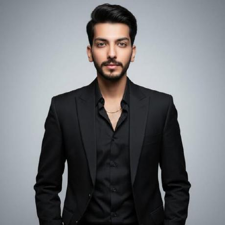

  

  

  
  
  

---

## 👋 About Me

I'm **Chaudhary Araiz**, an Artificial Intelligence undergraduate and digital solutions professional based in Lahore, Pakistan. I enjoy turning ideas into practical digital products, combining AI/ML knowledge with creative problem-solving, web experiences, and client-focused delivery.

- 🎓 **Education:** BS Artificial Intelligence, Superior University Lahore
- 🤖 **Focus areas:** Machine Learning, AI-powered solutions, AI image & video generation
- 🌐 **Digital skills:** SEO, data solutions, web development, analytics, and digital services
- 💼 **Agency:** Working on client projects through **Client Flow Agency**
- 🤝 **Availability:** Open to collaborations and freelance opportunities

## 🧰 Skills & Services

- **Artificial Intelligence & Machine Learning** — model development and applied AI concepts
- **AI Creative Production** — AI-generated images and video content
- **Web & Digital Solutions** — practical, user-focused online experiences
- **SEO & Digital Marketing** — search visibility and content optimization
- **Data & Analytics** — organized data workflows and insight-focused support

---

## 🚀 Client Flow Agency — Selected Projects

A selection of projects delivered by **Client Flow Agency**:

### 1. BlockOra Crypto Bank
A fintech-focused digital project in the crypto banking space, presented as part of the agency's project portfolio.

### 2. D3 Finance
A finance-focused digital project developed under the Client Flow Agency portfolio.

### 3. S by Shehnaz — Clothing Brand
A fashion and clothing brand project focused on presenting the brand through a polished digital experience.

## 💻 GitHub Projects & Code

Explore my public repositories for code, experiments, and development work. The repository list is kept live on GitHub so visitors can see the latest projects directly.

  

## 🌐 Find Me Online

- **Portfolio:** [araiz-portfolio-8z6t.vercel.app](https://araiz-portfolio-8z6t.vercel.app/index.html)
- **GitHub:** [github.com/chaudharyaraiz](https://github.com/chaudharyaraiz)
- **LinkedIn:** [linkedin.com/in/chaudhary-araiz](https://www.linkedin.com/in/chaudhary-araiz/)
- **Email:** [chaudharyaraiz02@gmail.com](mailto:chaudharyaraiz02@gmail.com)

---

<i>Chaudhary Araiz · Building ideas into digital experiences with Client Flow Agency.</i>

